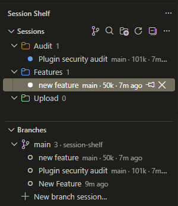
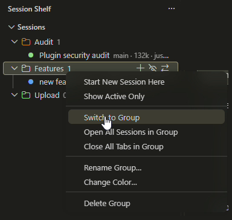
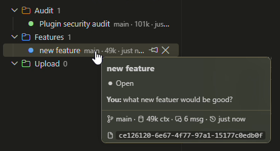
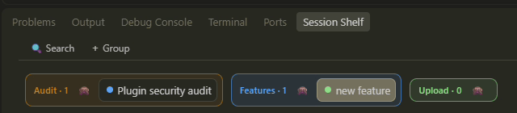

<div align="center">


# Session Shelf

**Organized, persistent session groups for [Claude Code](https://marketplace.visualstudio.com/items?itemName=anthropic.claude-code) in VS Code.**
Group conversations by workstream, close tabs freely, and reopen any session from its group.

[](https://marketplace.visualstudio.com/items?itemName=datasense.session-shelf)
[](https://github.com/nlombardi/session-shelf/actions/workflows/ci.yml)
[](LICENSE)
[](https://datasenseco.com)



</div>

---

## Overview

Claude Code opens each conversation as its own editor tab. Once you have more than a handful running, they are hard to keep track of, and closing a tab makes the conversation hard to find again.

Session Shelf adds a structured view of every Claude Code session in your workspace. Sessions live in named, colored groups that persist per workspace. **A grouped session stays in its group after its tab is closed**, so a group works as a durable record of a workstream rather than a snapshot of whatever happens to be open.

## Features

### Organization
- **Persistent groups.** Create named, colored groups and drag sessions between them, or start a new session directly inside a group. Groups collapse and persist per workspace.
- **Closed sessions are retained.** Closing a tab leaves the session in its group, marked as closed. Select it to reopen the conversation where it left off. Use the visibility toggle on a group to show only its open sessions when you want a narrower view.
- **Reliable assignment for new sessions.** A session grouped before Claude Code has written its first transcript keeps its group once it receives a permanent session ID.
- **Pinning.** Keep frequently used sessions at the top.
- **Switch between workstreams.** Open every session in a group at once, close a group's tabs, or **Switch to Group** to close the other Claude tabs and bring one group's sessions back.
- **Search inside conversations.** Find a session by what was said in it, not just its title. Results show the matching line from your prompt or Claude's reply.

### Visibility
- **Hover preview.** See the latest messages, git branch, context-token count, message count and last-active time without opening the session.
- **Status indicators.** Active, waiting for input, open and closed, at a glance.
- **Waiting-for-input alerts.** When Claude's last turn is an unanswered question or plan, the session moves to the top and the view shows a count badge.
- **Real-time attention (opt-in).** Optional Claude Code hooks raise the alert immediately, with an optional sound and OS notification.
- **Live subagents.** Expand a session to see the subagents it is currently running and inspect their tasks.

### Branches and worktrees
- **Group by branch.** Bucket sessions by the git branch each ran on.
- **Branches view.** List every git worktree of the repository with its sessions.
- **Cross-worktree resume.** Open a session from another worktree in a new window, resumed exactly where it was.
- **New branch session.** Create a worktree for a branch and start a Claude Code session in it in one step.

### Privacy
All data is read from your local `~/.claude` transcripts. Nothing is sent anywhere.

## Screenshots

**Grouped sessions in the Claude Code sidebar**


**Group actions: switch to a group, or open or close all of its sessions**



**Hover preview**



**Horizontal strip (bottom panel)**



## Installation

1. In VS Code, open **Extensions** (`Ctrl+Shift+X` / `Cmd+Shift+X`) and search for **Session Shelf**, or run:
   ```
   ext install datasense.session-shelf
   ```
2. Make sure the [Claude Code](https://marketplace.visualstudio.com/items?itemName=anthropic.claude-code) extension is installed and you have opened at least one conversation.
3. Open **Session Shelf** from the Activity Bar.

**Requirements:** VS Code 1.84 or later (or a compatible fork) and the Claude Code extension.

## Where it appears

| Location | Description |
| --- | --- |
| Activity Bar: **Session Shelf** | The main Sessions tree, always available. |
| Claude Code sidebar: **Session Tabs** | The same tree, shown inside Claude Code's sidebar while it is active. |
| Bottom panel: **Session Shelf** | A horizontal strip of grouped session chips. |

All three views share one data source and stay in sync. Right-click a session for actions such as pin and move to group, or a group to switch to it, open or close all of its sessions, and rename, recolor or delete it. The view title bar provides **Search**, **New Group** and **Refresh**.

## Search

Click **Search** in the view title bar (or run **Session Shelf: Search Sessions…**). Titles filter as you type. From three characters on, the text of every conversation in the workspace is searched as well: your prompts and Claude's replies, but not tool output or Claude's internal reasoning.

- Every word you type must appear in the same message, in any order and case. `auth retry` finds "retry the auth request".
- Each result shows how many messages matched and an excerpt of the first one, marked **You** or **Claude**.
- Selecting a title result opens the session. Selecting a conversation result also opens VS Code's find bar in that chat with the matched text, so it scrolls to and highlights the match (press `Enter` for the next one).

Transcripts are read once and cached; later searches only re-read sessions that have changed since.

## Switching between groups

Right-click a group, or click its inline swap icon, to work with all of its sessions at once. These actions are also in the Command Palette, where they ask which group to use.

| Action | What it does |
| --- | --- |
| **Switch to Group** | Closes the Claude tabs that are not in this group, then opens this group's closed sessions. Pinned sessions stay open. |
| **Open All Sessions in Group** | Opens every closed session in the group, including ones hidden by the group's eye toggle. |
| **Close All Tabs in Group** | Closes the group's open tabs. The sessions stay in the group, ready to reopen. |

To avoid interrupting Claude, these actions leave open any session where Claude is still working (replying or running a tool), and tell you which ones they left. Sessions waiting for your input are closed normally. Opening more than six sessions at once asks for confirmation first.

## Real-time attention (optional)

By default, waiting-for-input alerts are derived from the transcript, which Claude Code does not write in real time. To make alerts immediate, open the view's **...** menu and choose **Enable Real-time Attention**. After confirmation, three [Claude Code hooks](https://docs.claude.com/en/docs/claude-code/hooks) are added to `~/.claude/settings.json`:

| Hook | Fires when | Effect |
| --- | --- | --- |
| `PreToolUse` (`AskUserQuestion` / `ExitPlanMode`) | Claude asks a question or presents a plan | Alert on |
| `Notification` (permission prompt) | Claude needs permission | Alert on |
| `UserPromptSubmit` | You reply | Alert off |

Each hook writes or removes a marker file under `~/.claude/hooks/session-shelf/`, which the extension watches. Stale markers are ignored once the transcript catches up. **Disable Real-time Attention** removes the hooks and scripts and restores your `settings.json`. Start a new Claude Code session, or reload the window, after enabling.

When a session starts waiting, the extension can also play a sound and show a notification: a native OS notification when VS Code is in the background, or an in-app notification with a **Reveal** action when it is focused.

## Settings

| Setting | Default | Description |
| --- | --- | --- |
| `sessionShelf.maxRecentSessions` | `25` | Maximum closed sessions shown under Ungrouped. Open, pinned and grouped sessions are always shown. |
| `sessionShelf.showClosedSessions` | `true` | Include recently closed sessions, not only open tabs. |
| `sessionShelf.projectDirectory` | `""` | Override the `~/.claude/projects/<slug>` directory. Leave empty to auto-detect. |
| `sessionShelf.attentionSound` | `true` | Play a sound when a session needs input. Requires Real-time Attention. |
| `sessionShelf.attentionNotification` | `true` | Show a notification when a session needs input. Requires Real-time Attention. |
| `sessionShelf.attentionSoundName` | `"Ping"` | macOS system sound to play. Windows and Linux use the system notification sound. |

## How it works

- Claude Code tabs are detected through the VS Code Tab API (`TabInputWebview` with the `claudeVSCodePanel` view type).
- Session content is read from `~/.claude/projects/<workspace>/*.jsonl` and cached by file modification time, so unchanged sessions are never re-parsed.
- Sessions are opened or revealed with the Claude Code command `claude-vscode.editor.open`.
- Groups, assignments and pins are stored in VS Code's per-workspace state.
- Search reads only the text of user and assistant messages, keeps it in memory for the session, and never writes an index to disk.
- Whether Claude is still working in a session is judged from the transcript's last message: an unanswered prompt or tool result, or a reply that stopped to run a tool.

**Why a sidebar rather than the editor tab bar?** The VS Code extension API cannot customize editor-tab hovers, color or group individual webview tabs, or modify tabs beyond closing them. Extensions that restyle the tab bar do so by patching VS Code's installation files, which breaks on every update. Session Shelf uses supported APIs only. See [DESIGN.md](DESIGN.md) for the full analysis.

## Known limitations

- The views appear in the sidebar and bottom panel; the API cannot render them on the native editor tab bar.
- The Tab API does not expose a tab's session ID, so open tabs are matched to sessions by title. Two sessions with identical truncated titles can occasionally be matched in the wrong order until one of them updates.
- In a window with no folder open, sessions are read from the home directory (where Claude Code stores them), but Real-time Attention alerts do not fire. Open a folder to enable them and to keep each project's groups separate.
- The embedded sidebar view depends on Claude Code's view container. If a future Claude Code release renames it, a small update may be required.
- Claude Code provides no way to scroll to a specific message, so a conversation result is located with the chat's find bar instead. The search text is entered by pasting it, and your clipboard text is restored straight after (a non-text clipboard, such as an image, is replaced). If the words you searched are far apart in the message, the find bar looks for the longest one, which may hit an earlier message first. When Claude Code opens conversations in the sidebar instead of a tab, the session opens without the find step.
- Group actions are available in the sidebar trees and the Command Palette, not yet in the bottom-panel strip.
- A session stopped at a permission prompt looks like it is still running a tool, so bulk close leaves it open for up to 30 minutes. With Real-time Attention enabled it is recognized as waiting for you and closes normally.

## Development

```bash
npm install
npm run watch      # or: npm run compile
npm test           # headless tests: data layer, group store, search, transcript parsing
```

Press **F5** to launch an Extension Development Host. Package with `npx @vscode/vsce package --no-dependencies`. The code is layered `model → data → view → wiring`; see [DESIGN.md](DESIGN.md) for details.

## License and attribution

Released under the [MIT License](LICENSE).

Session Shelf is a fork of [Claude Code Tabs](https://github.com/yousefkadah/claude-session-tabs) by yousefkadah, extended so that grouped sessions persist after their tabs are closed. It is not affiliated with or endorsed by Anthropic.

---

<div align="center">

<a href="https://datasenseco.com"></a>

**Built by [Data Sense](https://datasenseco.com)**
*From Raw Data to Real Decisions.*

</div>
